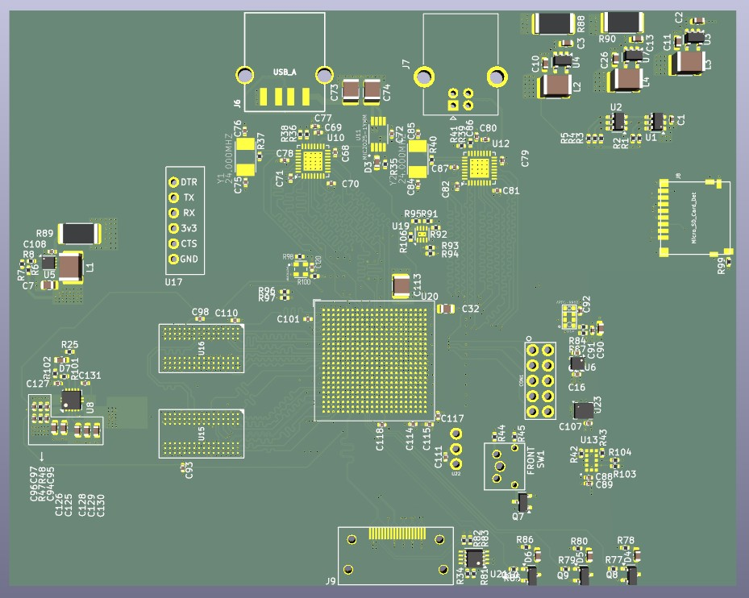
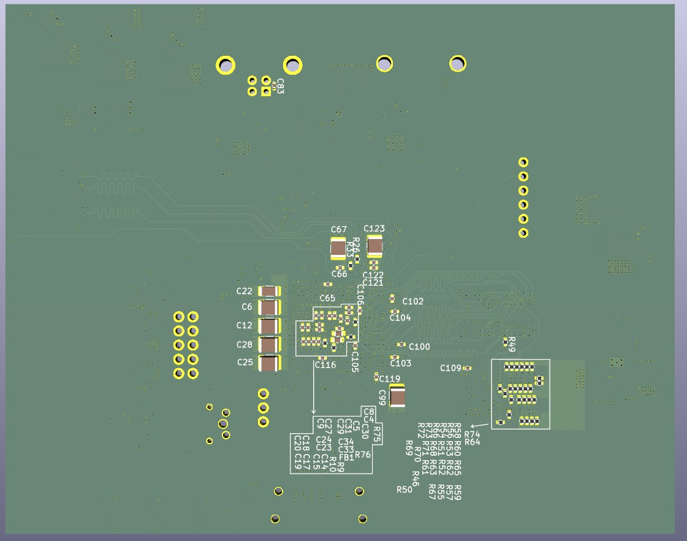

# 8-слойная плата на Zynq-7020 с 32-битной DDR3

Учебный проект в KiCad по схемотехнике и разводке высокоскоростных интерфейсов. Основная задача — вывести сигналы из BGA-484 и развести DDR3, HDMI и USB на плате размером 120 × 95 мм.

| Верхняя сторона · F.Cu | Нижняя сторона · B.Cu |
| :---: | :---: |
|  |  |

## Архитектура

| Узел | Реализация |
| --- | --- |
| SoC | Zynq XC7Z020 в корпусе CLG484 с шагом выводов 0,8 мм |
| Память | Две микросхемы DDR3 по 16 бит, общая шина данных 32 бита |
| Видео | HDMI Type A, три пары данных TMDS и тактовая пара |
| USB | USB 2.0 в режимах host и device, два PHY USB3320 |
| Хранение и отладка | SPI Flash, microSD, UART и JTAG |
| Периферия | Аудиоинтерфейс I²S, датчики движения и расстояния |

## Разводка платы

Стек меди сверху вниз включает четыре сигнальных слоя, два слоя GND и два слоя питания.

| Слой | F.Cu | In1.Cu | In2.Cu | In3.Cu | In4.Cu | In5.Cu | In6.Cu | B.Cu |
| --- | --- | --- | --- | --- | --- | --- | --- | --- |
| Назначение | Сигналы | GND | Сигналы | Питание | Питание | Сигналы | GND | Сигналы |

